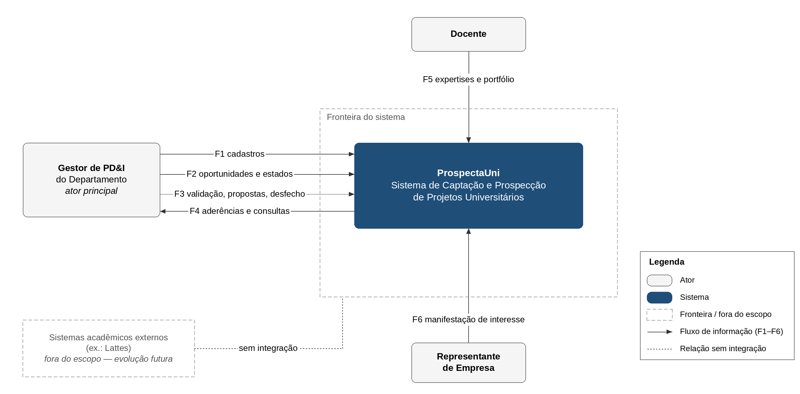
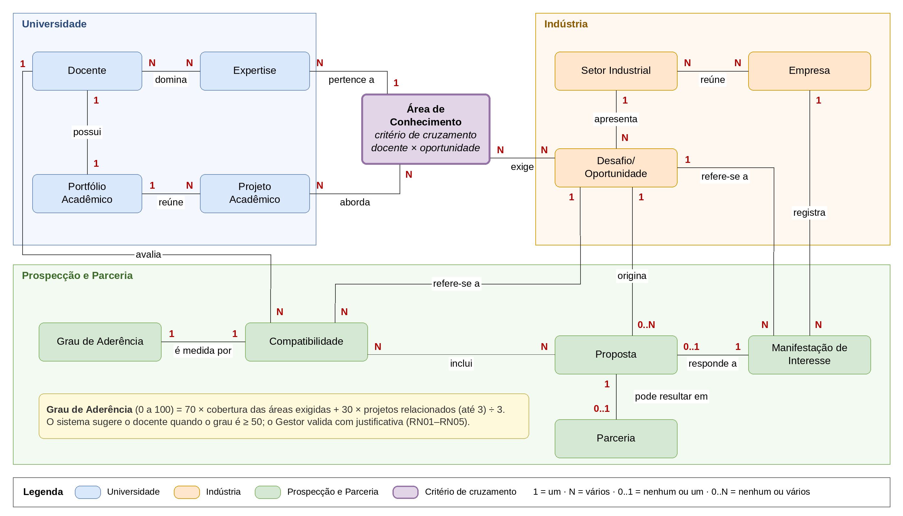
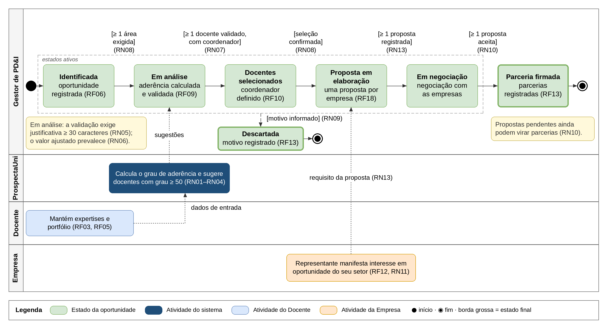

::: {custom-style="Capa Instituição"}
Universidade Federal do Recôncavo da Bahia — UFRB
:::

::: {custom-style="Capa Instituição"}
Análise de Sistemas · 2026.2 · Prof. Inácio Borges
:::

::: {custom-style="Capa Autores"}
Luiz Augusto dos Santos Oliveira e Luiz Sérgio
:::

::: {custom-style="Capa Título"}
ProspectaUni — Sistema de Captação e Prospecção de Projetos Universitários
:::

::: {custom-style="Capa Subtítulo"}
Fase 1 — Concepção, Escopo e Domínio
:::

::: {custom-style="Capa Local"}
Cruz das Almas – BA\
2026
:::

```{=openxml}
<w:p><w:pPr><w:pStyle w:val="SumarioTitulo"/></w:pPr><w:r><w:t>Sumário</w:t></w:r></w:p>
<w:p><w:r><w:fldChar w:fldCharType="begin" w:dirty="true"/></w:r><w:r><w:instrText xml:space="preserve"> TOC \o "1-2" \h \z \u </w:instrText></w:r><w:r><w:fldChar w:fldCharType="separate"/></w:r><w:r><w:t>Atualize o sumário: clique com o botão direito aqui e escolha "Atualizar campo" (ou tecle F9).</w:t></w:r><w:r><w:fldChar w:fldCharType="end"/></w:r></w:p>
<w:p><w:r><w:t>@@SECAO_SEM_NUMERO@@</w:t></w:r></w:p>
```

# 1 Visão e Escopo

## Problema atual
O departamento reúne docentes com expertises e projetos de valor para a indústria, mas essas informações ficam dispersas. Não há um registro único que relacione os conhecimentos dos docentes às necessidades dos setores industriais. Por isso, oportunidades de parceria passam despercebidas, a escolha de docentes depende da memória de quem conhece cada um, e não se sabe quais empresas teriam interesse nos resultados. Também falta acompanhar cada oportunidade do momento em que é identificada até o seu desfecho.

## Público-alvo
- **Gestor de PD&I do Departamento**: principal usuário; conduz a prospecção de parcerias.
- **Docentes**: mantêm suas expertises e seu portfólio acadêmico.
- **Representantes de empresas**: manifestam interesse nas oportunidades dos setores em que atuam.

## Proposta de valor
O ProspectaUni reúne em um só lugar docentes, portfólios, setores, empresas e oportunidades. Para cada oportunidade, calcula o grau de aderência de cada docente, com base nas áreas de conhecimento exigidas e na experiência anterior. O Gestor valida ou ajusta o resultado e registra uma justificativa. Antes de negociar, o departamento registra uma proposta com a solução, os docentes selecionados e a empresa interessada. Em seguida, acompanha a oportunidade desde a identificação até a parceria firmada ou o descarte, e consulta as empresas interessadas.

## Escopo resumido
**Dentro:**
- cadastro de docentes, expertises, áreas de conhecimento e projetos acadêmicos;
- cadastro de setores industriais, empresas e contatos;
- registro de desafios e oportunidades;
- cálculo e validação da compatibilidade entre docentes e oportunidades;
- registro do interesse das empresas;
- acompanhamento do ciclo de vida da parceria;
- consultas sobre docentes, portfólios, setores e empresas.

**Fora:** gestão financeira e contratos, acompanhamento da execução após a parceria firmada e integração com sistemas externos.

## Benefícios esperados
- Escolha de docentes mais rápida e baseada em critérios registrados.
- Menos oportunidades perdidas, com visibilidade das que ainda não têm docentes compatíveis.
- Aproximação entre universidade e empresas dos setores relacionados.
- Histórico das decisões de compatibilidade, com suas justificativas.
- Visão clara do andamento de cada parceria.

# 2 Glossário

| Termo | Definição | Origem |
|----------------------|---------------------------------------------------------------|---------------|
| Área de Conhecimento | Campo de saber, com nome, descrição e palavras-chave, ao qual as expertises dos docentes se relacionam e que as oportunidades podem exigir. | RN-MM-02, RN-MM-10 |
| Compatibilidade | Correspondência registrada entre uma oportunidade e um docente, com grau de aderência e justificativa, sugerida pelo cálculo e validada pelo Gestor. | RN-MM-13, RN-MM-15, D3 |
| Desafio/Oportunidade | Problema a resolver ou possibilidade de inovação de um setor industrial, com descrição, data de identificação, prioridade, situação e áreas de conhecimento exigidas. | RN-MM-08 a RN-MM-10 |
| Docente | Professor vinculado ao departamento, com dados cadastrais, expertises e portfólio acadêmico, que pode contribuir para soluções industriais. | RN-MM-01, RN-MM-02 |
| Empresa | Organização que atua em um ou mais setores industriais, com dados cadastrais, área de atuação e contatos, e que pode se interessar por oportunidades. | RN-MM-11, RN-MM-12 |
| Expertise | Conhecimento específico dominado por um docente, relacionado a uma área de conhecimento; pode ser compartilhada por vários docentes. | RN-MM-02, RN-MM-03 |
| Grau de Aderência | Medida, de 0 a 100, de quanto um docente atende a uma oportunidade; calculado pelo sistema e podendo ser ajustado pelo Gestor com justificativa. | RN-MM-15, D3 |
| Manifestação de Interesse | Registro de que uma empresa demonstra interesse em uma oportunidade e, se for o caso, em implementar soluções relacionadas a ela. | RN-MM-14 |
| Parceria | Acordo entre o departamento, docentes selecionados e uma empresa para desenvolver um projeto a partir de uma proposta aceita; uma oportunidade pode gerar várias parcerias, e a primeira leva a oportunidade ao estado Parceria firmada. | D1, D50, RN-MM-14 |
| Portfólio Acadêmico | Conjunto de projetos acadêmicos que um docente coordenou ou orientou, usado para verificar sua experiência prévia. | RN-MM-04, RN-MM-16 |
| Projeto Acadêmico | Trabalho de pesquisa, desenvolvimento ou inovação com título, descrição, período, objetivos, resultados, situação e áreas de conhecimento, indicadas pelo Docente, que compõe o portfólio de docentes. | RN-MM-05, RN-MM-06, D26 |
| Proposta | Documento elaborado pelo departamento, a partir de uma oportunidade, que descreve a solução a oferecer e os docentes selecionados e se destina a uma empresa interessada; cada empresa interessada recebe no máximo uma proposta por oportunidade, e ao menos uma é exigida antes da negociação. | D28, D30, D50, RN-MM-14 |
| Setor Industrial | Segmento produtivo (por exemplo, alimentos ou energia), com identificação, descrição e áreas de atuação, que reúne empresas e apresenta desafios e oportunidades. | RN-MM-07, RN-MM-08, RN-MM-12 |

Table: Quadro 1 — Glossário do sistema

::: {custom-style="Fonte"}
Fonte: elaborado pelos autores (2026).
:::

# 3 Requisitos Funcionais

Prioridade: Alta = sem ele o processo central (oportunidade → compatibilidade → parceria) não funciona; Média = apoia o processo; Baixa = conveniência. As Regras de Negócio relacionadas (RN01…) aparecem na coluna Origem.

## Módulo Cadastros
| ID | Nome | Descrição | Prioridade | Ator | Origem |
|-------|-----------------|--------------------------------------------|----------|----------|------------|
| RF01 | Manter docentes | O sistema deve permitir que o Gestor inclua, altere e inative docentes do departamento, com nome, matrícula, e-mail, departamento e currículo resumido. | Alta | Gestor | RN-MM-01, RN-MM-02 |
| RF02 | Manter áreas de conhecimento | O sistema deve permitir que o Gestor inclua, altere e inative áreas de conhecimento, com nome, descrição e palavras-chave. | Alta | Gestor | RN-MM-02, RN-MM-10, D8 |
| RF03 | Manter expertises | O sistema deve permitir que o Docente associe e remova suas expertises, cada uma relacionada a uma área de conhecimento. | Alta | Docente | RN-MM-02, RN-MM-03, D8 |
| RF04 | Manter setores industriais e empresas | O sistema deve permitir que o Gestor mantenha setores industriais e empresas, vinculando cada empresa a um ou mais setores e registrando seus contatos. | Alta | Gestor | RN-MM-07, RN-MM-11, RN-MM-12, D8 |

Table: Quadro 2 — Requisitos funcionais — módulo Cadastros

::: {custom-style="Fonte"}
Fonte: elaborado pelos autores (2026).
:::

## Módulo Portfólio
| ID | Nome | Descrição | Prioridade | Ator | Origem |
|-------|-----------------|--------------------------------------------|----------|----------|------------|
| RF05 | Manter portfólio acadêmico | O sistema deve permitir que o Docente registre e atualize os projetos acadêmicos de seu portfólio, informando título, descrição, período, objetivos, resultados, situação, as áreas de conhecimento do projeto e seu papel de coordenador ou orientador. | Alta | Docente | RN-MM-04, RN-MM-05, RN-MM-06, D8, D26 |

Table: Quadro 3 — Requisitos funcionais — módulo Portfólio

::: {custom-style="Fonte"}
Fonte: elaborado pelos autores (2026).
:::

## Módulo Oportunidades
| ID | Nome | Descrição | Prioridade | Ator | Origem |
|-------|-----------------|--------------------------------------------|----------|----------|------------|
| RF06 | Registrar desafio/oportunidade | O sistema deve permitir que o Gestor registre um desafio/oportunidade em um setor industrial, com descrição, data de identificação, prioridade e áreas de conhecimento exigidas, iniciando no estado Identificada. | Alta | Gestor | RN-MM-08, RN-MM-09, RN-MM-10, D1, D8, RN08 |
| RF07 | Alterar estado da oportunidade | O sistema deve permitir que o Gestor altere o estado de uma oportunidade entre Identificada, Em análise, Docentes selecionados, Proposta em elaboração, Em negociação, Parceria firmada e Descartada, registrando data, autor e histórico de cada mudança, conforme as transições permitidas. | Alta | Gestor | D1, D7, RN08, RN09, RN13 |

Table: Quadro 4 — Requisitos funcionais — módulo Oportunidades

::: {custom-style="Fonte"}
Fonte: elaborado pelos autores (2026).
:::

## Módulo Compatibilidade
| ID | Nome | Descrição | Prioridade | Ator | Origem |
|-------|-----------------|--------------------------------------------|----------|----------|------------|
| RF08 | Calcular grau de aderência | O sistema deve calcular, para uma oportunidade selecionada pelo Gestor, o grau de aderência de cada docente, a partir das áreas de conhecimento exigidas e do portfólio acadêmico, e listar os docentes em ordem decrescente. | Alta | Gestor | RN-MM-13, RN-MM-15, D3, RN01, RN02, RN03, RN04 |
| RF09 | Validar compatibilidade | O sistema deve permitir que o Gestor valide, ajuste ou rejeite o grau de aderência sugerido de um docente para uma oportunidade, exigindo justificativa, e registre a compatibilidade. | Alta | Gestor | RN-MM-15, D3, RN04, RN05, RN06 |
| RF10 | Selecionar docentes da oportunidade | O sistema deve permitir que o Gestor selecione, entre os docentes com compatibilidade validada, os que participarão da oportunidade, indicando o coordenador, e avance a oportunidade ao estado Docentes selecionados. | Alta | Gestor | RN-MM-13, RN-MM-16, D1, RN07, RN08 |
| RF11 | Consultar projetos anteriores relacionados | O sistema deve permitir que o Gestor consulte, para uma oportunidade, os projetos acadêmicos dos portfólios que se relacionam às suas áreas de conhecimento, com o docente e o papel exercido. | Média | Gestor | RN-MM-16, Q-02, Q-07, RN03 |

Table: Quadro 5 — Requisitos funcionais — módulo Compatibilidade

::: {custom-style="Fonte"}
Fonte: elaborado pelos autores (2026).
:::

## Módulo Interesse e Parceria
| ID | Nome | Descrição | Prioridade | Ator | Origem |
|-------|-----------------|--------------------------------------------|----------|----------|------------|
| RF12 | Registrar manifestação de interesse | O sistema deve permitir que o Representante de Empresa registre a manifestação de interesse de sua empresa em uma oportunidade de um setor em que ela atua, indicando se deseja implementar a solução. | Alta | Representante de Empresa | RN-MM-14, RN11 |
| RF13 | Registrar desfecho da parceria | O sistema deve permitir que o Gestor registre cada parceria firmada a partir de uma proposta aceita, com a empresa e os docentes envolvidos, as propostas não aceitas, ou o descarte da oportunidade com motivo. | Alta | Gestor | D1, RN-MM-14, RN09, RN10, D50 |
| RF18 | Registrar proposta | O sistema deve permitir que o Gestor registre as propostas de uma oportunidade no estado Proposta em elaboração, uma por empresa com manifestação de interesse, com resumo da solução e docentes selecionados. | Alta | Gestor | D1, D28, D30, RN13, D50 |

Table: Quadro 6 — Requisitos funcionais — módulo Interesse e Parceria

::: {custom-style="Fonte"}
Fonte: elaborado pelos autores (2026).
:::

## Módulo Consultas
| ID | Nome | Descrição | Prioridade | Ator | Origem |
|-------|-----------------|--------------------------------------------|----------|----------|------------|
| RF14 | Consultar docentes e portfólios por área | O sistema deve permitir que o Gestor consulte docentes compatíveis com uma oportunidade ou área de conhecimento e veja os projetos do portfólio de cada um. | Alta | Gestor | RN-MM-16, Q-01, Q-02, RN06 |
| RF15 | Consultar setores compatíveis com as competências | O sistema deve permitir que o Gestor consulte os setores industriais cujas oportunidades são compatíveis com as expertises disponíveis no departamento. | Média | Gestor | Q-03 |
| RF16 | Consultar empresas por oportunidade | O sistema deve permitir que o Gestor consulte as empresas que atuam nos setores de uma oportunidade e as que já manifestaram interesse nela. | Média | Gestor | RN-MM-14, Q-04, Q-05 |
| RF17 | Listar oportunidades sem docentes compatíveis | O sistema deve permitir que o Gestor liste as oportunidades que ainda não possuem docentes compatíveis identificados. | Média | Gestor | Q-06, RN12 |

Table: Quadro 7 — Requisitos funcionais — módulo Consultas

::: {custom-style="Fonte"}
Fonte: elaborado pelos autores (2026).
:::

## Cobertura
- Cadastros simples: RF01 a RF05 e RF06 (registro da oportunidade, tratado como cadastro por prudência) = 6 de 18 (33%, limite de 40%). Transacionais: RF07 a RF18 = 12 de 18 (67%).
- Q-01: RF14 · Q-02: RF11, RF14 · Q-03: RF15 · Q-04: RF16 · Q-05: RF16 · Q-06: RF17 · Q-07: RF11.

# 4 Requisitos Não Funcionais

| ID | Categoria | Descrição | Critério de aceitação | Origem |
|-------|-------------|-----------------------------------|---------------------------------|------------|
| RNF01 | Desempenho | A consulta de docentes compatíveis com uma oportunidade (RF14) deve retornar o resultado rapidamente. | 95% das consultas em até 3 s, com 500 docentes e 200 oportunidades cadastrados. | RF14, D35 |
| RNF02 | Desempenho | O cálculo do grau de aderência de uma oportunidade para todos os docentes (RF08) deve ser concluído em tempo adequado ao uso interativo. | 95% dos cálculos em até 10 s, com 500 docentes e 200 oportunidades cadastrados. | RF08, RN02, D35 |
| RNF03 | Segurança | O acesso deve exigir identificação do usuário, e cada ator (Gestor, Docente, Representante de Empresa) só pode executar as funções do seu papel; por exemplo, só o Gestor altera o estado da oportunidade (RN08). | Em testes de acesso, 100% das tentativas de executar função de outro papel são bloqueadas e registradas. | D2, D8, RN08 |
| RNF04 | Privacidade/LGPD | Os dados pessoais de docentes e os contatos de empresas só devem ser visíveis a quem tem papel autorizado e devem poder ser excluídos ou anonimizados a pedido do titular. | Pedido de exclusão ou anonimização atendido em até 30 dias; em testes de acesso, 0 acessos a dados pessoais por papel não autorizado. | RN-MM-02, RN-MM-11, Diretriz (LGPD) |
| RNF05 | Usabilidade | Um Gestor sem treinamento prévio deve conseguir registrar uma oportunidade e calcular a aderência dos docentes sem ajuda externa. | Em teste com 5 usuários, ao menos 80% concluem a tarefa em até 30 minutos. | RF06, RF08 |
| RNF06 | Disponibilidade | O sistema deve estar disponível no horário de uso do departamento. | Disponibilidade mínima de 95% por mês, em horário comercial (segunda a sexta, das 8h às 18h). | Diretriz |
| RNF07 | Manutenibilidade | A nota mínima de sugestão, os pesos da fórmula do grau de aderência e o teto de projetos anteriores devem poder ser alterados sem reescrever o sistema, e o histórico de mudanças de estado das oportunidades deve ser conservado. | Cada parâmetro (RN02, RN04) é alterável por configuração, sem nova versão do sistema; histórico de mudanças de estado guardado por 5 anos. | RN02, RN04, RF07, D21, D23, D37 |

Table: Quadro 8 — Requisitos não funcionais

::: {custom-style="Fonte"}
Fonte: elaborado pelos autores (2026).
:::

# 5 Regras de Negócio

| ID | Nome | Descrição | Tipo | RFs relacionados | Origem |
|------|---------------|-------------------------------------------|----------|------------|--------------|
| RN01 | Cobertura das áreas exigidas | A cobertura de um docente em uma oportunidade é a razão entre o número de áreas de conhecimento exigidas pela oportunidade que o docente possui como expertise e o número total de áreas exigidas. | Cálculo | RF08 | RN-MM-10, RN-MM-13, D21 |
| RN02 | Grau de aderência | O grau de aderência, de 0 a 100, é 70 × cobertura (RN01) + 30 × (menor valor entre o número de projetos anteriores relacionados e 3) ÷ 3. | Cálculo | RF08 | RN-MM-15, D3, D21 |
| RN03 | Projeto anterior relacionado | É projeto anterior relacionado todo projeto acadêmico do portfólio do docente, como coordenador ou orientador, cujas áreas de conhecimento, indicadas pelo Docente ao registrá-lo, incluem ao menos uma área de conhecimento exigida pela oportunidade. | Derivação | RF08, RF11 | RN-MM-04, RN-MM-16, D22, D26 |
| RN04 | Nota mínima para sugestão | Um docente só é sugerido para uma oportunidade quando seu grau de aderência é igual ou superior a 50; abaixo disso, a compatibilidade só existe se o Gestor a registrar manualmente, com justificativa. | Restrição | RF08, RF09 | RN-MM-13, D23 |
| RN05 | Justificativa obrigatória | Toda compatibilidade registrada pelo Gestor, validada, ajustada, rejeitada ou manual, deve ter justificativa de no mínimo 30 caracteres; sem ela, a compatibilidade não pode ser confirmada. | Restrição | RF09 | RN-MM-15, D3, D25 |
| RN06 | Valor validado prevalece | Quando o Gestor ajusta o grau de aderência, o valor ajustado passa a ser o valor oficial da compatibilidade, e o valor calculado pelo sistema permanece registrado para consulta. | Derivação | RF09, RF14 | RN-MM-15, D3 |
| RN07 | Docentes mínimos da oportunidade | Uma oportunidade só pode ter docentes selecionados se cada um tiver compatibilidade validada, e só pode seguir adiante se houver ao menos um docente selecionado, que deve ser o coordenador. | Restrição | RF10 | RN-MM-06, RN-MM-13, D25 |
| RN08 | Sequência do ciclo de vida | A oportunidade percorre, na ordem, os estados Identificada, Em análise, Docentes selecionados, Proposta em elaboração, Em negociação e Parceria firmada; apenas o Gestor altera o estado, sem pular estados. A passagem para Em análise exige ao menos uma área de conhecimento exigida, a passagem para Docentes selecionados exige a RN07 e a passagem para Em negociação exige a RN13. | Fluxo/Estado | RF06, RF07, RF10 | D1, D7, D24, D28 |
| RN09 | Descarte e estados finais | Uma oportunidade pode ser descartada a partir de qualquer estado que não seja final, mediante motivo obrigatório. Parceria firmada e Descartada são estados finais: a oportunidade não muda mais de estado; em Parceria firmada, ainda pode receber novas parcerias conforme a RN10. | Fluxo/Estado | RF07, RF13 | D1, D24, D51 |
| RN10 | Condições da parceria firmada | Uma oportunidade só passa de Em negociação para Parceria firmada quando ao menos uma proposta for aceita pela empresa destinatária, com os docentes selecionados mantidos. Cada proposta aceita gera uma parceria. Em Parceria firmada, as propostas ainda pendentes podem gerar novas parcerias ou ser registradas como não aceitas. | Restrição | RF13 | RN-MM-14, D1, D24, D50, D51 |
| RN11 | Interesse apenas em setor de atuação | Uma empresa só pode manifestar interesse em oportunidades de setores industriais em que atua. | Restrição | RF12 | RN-MM-11, RN-MM-12, RN-MM-14 |
| RN12 | Oportunidade sem docentes compatíveis | Uma oportunidade é considerada sem docentes compatíveis quando nenhum docente atinge a nota mínima (RN04) e nenhuma compatibilidade foi registrada manualmente. | Derivação | RF17 | Q-06, RN-MM-13, D23 |
| RN13 | Proposta registrada antes da negociação | Uma oportunidade só passa de Proposta em elaboração para Em negociação se houver ao menos uma proposta registrada. Cada proposta se destina a uma única empresa com manifestação de interesse na oportunidade e inclui os docentes selecionados; cada empresa interessada recebe no máximo uma proposta por oportunidade. | Restrição | RF07, RF18 | D1, D28, D30, D32, D50 |

Table: Quadro 9 — Regras de negócio

::: {custom-style="Fonte"}
Fonte: elaborado pelos autores (2026).
:::

# Apêndice A — Rastreabilidade

## Regras do minimundo (RN-MM) × requisitos
| Origem | Descrição resumida | RFs | RNs |
|--------------|----------------------------------------------------|-----------------|-----------------|
| RN-MM-01 | Departamento com vários docentes | RF01 | — |
| RN-MM-02 | Docente com dados cadastrais e expertises por área | RF01, RF02, RF03 | — |
| RN-MM-03 | Expertise compartilhada entre docentes (N:N) | RF03 | — |
| RN-MM-04 | Portfólio com projetos coordenados ou orientados | RF05 | RN03 |
| RN-MM-05 | Dados do projeto acadêmico | RF05 | — |
| RN-MM-06 | Um coordenador e um ou mais orientadores por projeto | RF05 | RN07 |
| RN-MM-07 | Setores industriais com descrição e atuação | RF04 | — |
| RN-MM-08 | Setor com vários desafios e oportunidades | RF06 | — |
| RN-MM-09 | Dados do desafio/oportunidade | RF06 | — |
| RN-MM-10 | Oportunidade exige várias áreas de conhecimento | RF02, RF06 | RN01 |
| RN-MM-11 | Empresas vinculadas a setores, com contatos | RF04, RF12 | RN11 |
| RN-MM-12 | Empresa em vários setores; setor com várias empresas | RF04 | RN11 |
| RN-MM-13 | Compatibilidade N:N entre oportunidades e docentes | RF08, RF09, RF10 | RN01, RN04, RN07, RN12 |
| RN-MM-14 | Interesse e implementação de projetos pelas empresas | RF12, RF13, RF16, RF18 | RN10, RN11, RN13 |
| RN-MM-15 | Registro de compatibilidade com justificativa e grau de aderência | RF08, RF09 | RN02, RN04, RN05, RN06 |
| RN-MM-16 | Consulta de portfólios para apoiar a seleção | RF10, RF11, RF14 | RN03 |

Table: Quadro 10 — Regras do minimundo (RN-MM) × requisitos e regras de negócio

::: {custom-style="Fonte"}
Fonte: elaborado pelos autores (2026).
:::

## Perguntas do minimundo (Q) × requisitos
| Origem | Pergunta | RFs | RNs |
|--------------|----------------------------------------------------|-----------------|-----------------|
| Q-01 | Docentes com conhecimentos compatíveis com um desafio | RF08, RF14 | RN01, RN02 |
| Q-02 | Projetos anteriores no portfólio desses docentes | RF11, RF14 | RN03 |
| Q-03 | Setores com oportunidades compatíveis com as competências | RF15 | RN04 |
| Q-04 | Empresas dos setores de uma oportunidade | RF16 | RN11 |
| Q-05 | Empresas que já demonstraram interesse | RF12, RF16 | RN11 |
| Q-06 | Oportunidades sem docentes compatíveis | RF17 | RN12 |
| Q-07 | Docentes com experiência em projetos semelhantes | RF11 | RN03 |

Table: Quadro 11 — Perguntas do minimundo (Q-01 a Q-07) × requisitos e regras de negócio

::: {custom-style="Fonte"}
Fonte: elaborado pelos autores (2026).
:::

## RFs × RNFs de apoio
RF08: RNF02 · RF14: RNF01 · todos: RNF03, RNF04, RNF06 · RF06 e RF08: RNF05 · RF07, RN02, RN04: RNF07.

## Lacunas
Nenhuma linha vazia: toda RN-MM e toda Q está atendida por ao menos um RF. As RN-MM sem RN associada (01, 02, 03, 05, 07, 08, 09) são cadastrais e atendidas por RFs.

```{=openxml}
<w:p><w:r><w:t>@@SECAO_RETRATO@@</w:t></w:r></w:p>
```

# Apêndice B — Diagramas

::: {custom-style="Legenda"}
Figura 1 — Diagrama de contexto do ProspectaUni
:::

::: {custom-style="Figura"}
{width=24cm}
:::

::: {custom-style="Fonte"}
Fonte: elaborado pelos autores (2026).\
Nota: o sistema (azul escuro), dentro de sua fronteira, troca seis fluxos de informação (F1 a F6) com os três atores (cinza); o Quadro 12 detalha cada fluxo e seus requisitos funcionais. Sistemas acadêmicos externos ficam fora do escopo.
:::

| Fluxo | De → Para | Informação | RFs |
|--------|--------------------|----------------------------------------------------|--------------------|
| F1 | Gestor → Sistema | Docentes, áreas de conhecimento, setores industriais e empresas | RF01, RF02, RF04 |
| F2 | Gestor → Sistema | Desafios/oportunidades e mudança de estado | RF06, RF07 |
| F3 | Gestor → Sistema | Validação da compatibilidade, seleção de docentes, propostas e desfecho | RF09, RF10, RF18, RF13 |
| F4 | Sistema → Gestor | Graus de aderência sugeridos e consultas (Q-01 a Q-07) | RF08, RF11, RF14 a RF17 |
| F5 | Docente → Sistema | Expertises e portfólio acadêmico | RF03, RF05 |
| F6 | Representante de Empresa → Sistema | Manifestação de interesse em oportunidade do seu setor | RF12 |

Table: Quadro 12 — Fluxos de informação do diagrama de contexto

::: {custom-style="Fonte"}
Fonte: elaborado pelos autores (2026).
:::

```{=openxml}
<w:p><w:r><w:br w:type="page"/></w:r></w:p>
```

::: {custom-style="Legenda"}
Figura 2 — Mapa do domínio
:::

::: {custom-style="Figura"}
{width=23cm}
:::

::: {custom-style="Fonte"}
Fonte: elaborado pelos autores (2026).\
Nota: cada caixa é um termo do Glossário, agrupado em Universidade (azul), Indústria (laranja) e Prospecção e Parceria (verde); a Área de Conhecimento (lilás) é o critério de cruzamento entre docentes e oportunidades. Cada linha é uma relação, lida pelo verbo, com a quantidade em cada ponta (1, N, 0..1, 0..N).
:::

```{=openxml}
<w:p><w:r><w:br w:type="page"/></w:r></w:p>
```

::: {custom-style="Legenda"}
Figura 3 — Ciclo da oportunidade e da parceria
:::

::: {custom-style="Figura"}
{width=24cm}
:::

::: {custom-style="Fonte"}
Fonte: elaborado pelos autores (2026).\
Nota: cada raia é um ator e os estados da oportunidade ficam na raia do Gestor. Cada transição mostra [condição] (regra de negócio); a seta tracejada é o descarte, possível a partir de qualquer estado ativo, e as pontilhadas são informações entre atores.
:::
